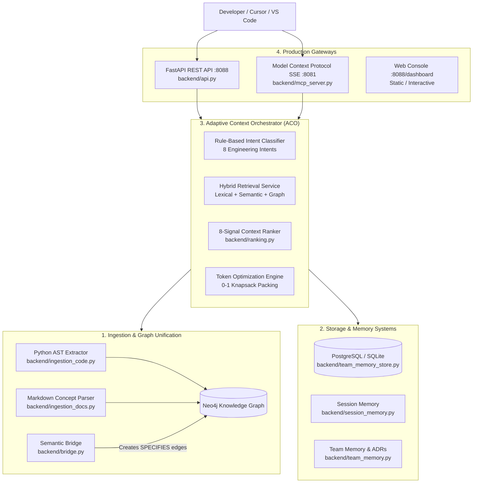

# Synapse: Adaptive Engineering Memory Platform
## Comprehensive Agent Onboarding & System Context (`CONTEXT.md`)

> **Notice for AI Coding Agents in Antigravity IDE / Antigravity CLI:**  
> This document is the authoritative context primer for the Synapse project. It captures the entire platform architecture, completed milestones, key technical decisions, codebase layout, documentation sitemap, and operational guidelines. Read this file before undertaking any modifications.

---

## 1. Project Overview & Core Mission

### 1.1 What is Synapse?
**Synapse** is an adaptive engineering memory and context optimization platform for AI coding assistants. It bridges the gap between static AST code graphs, architectural documentation, and persistent team knowledge.

### 1.2 Core Problems Solved
1. **Repeated Rediscovery & Session Amnesia:** Standard coding assistants lose architectural decisions and debugging takeaways once a chat session terminates. Synapse provides persistent, cross-session, multi-tenant engineering memory.
2. **Structural Blindness in Plain-Text RAG:** Traditional chunk-based vector search misses AST relationships (callers, callees, inheritance, imports). Synapse constructs a unified Neo4j property graph linking code symbols directly to technical specs (`SPECIFIES`).
3. **The "Lost-in-the-Middle" Prompt Inefficiency:** Dumping entire files into large context windows wastes tokens, increases time-to-first-token (TTFT), and degrades LLM reasoning. Synapse uses **0-1 Knapsack utility-density optimization** under strict token budgets to pack high-density prompt contexts.

---

## 2. Master System Architecture & Components



### Core Subsystems in `backend/`
| Module | Primary Responsibility |
|---|---|
| [`backend/models.py`](file:///C:/FYP/backend/models.py) | Strongly typed dataclasses: `CodeSymbol`, `DocumentEntity`, `GraphEdge`, `Memory`, `OrchestratedContext`, `IntentAnalysisResult`. |
| [`backend/orchestrator.py`](file:///C:/FYP/backend/orchestrator.py) | **Adaptive Context Orchestrator (ACO)**: Classifies query intent across 8 types, selects retrieval strategies, triggers deduplication, and coordinates Knapsack packing. |
| [`backend/hybrid_retrieval.py`](file:///C:/FYP/backend/hybrid_retrieval.py) | **Multi-channel fusion**: Fuses BM25 lexical keyword scoring, dense cosine vector similarity, continuous token overlap ratios, and Neo4j BFS graph traversal. |
| [`backend/ranking.py`](file:///C:/FYP/backend/ranking.py) | **8-Signal Context Ranker**: Computes semantic relevance, lexical relevance, graph relevance, freshness, confidence, repository match, source reliability, and token cost efficiency. |
| [`backend/token_optimizer.py`](file:///C:/FYP/backend/token_optimizer.py) | **Token Optimization Engine**: Executes 4-stage pipeline (raw $\to$ deduplication $\to$ structured compaction $\to$ Knapsack budget enforcement). Supports `none`, `deterministic`, and `llm` modes. Enforces non-negotiable provenance preservation via `ProvenanceGuardrail`. |
| [`backend/semantic_matcher.py`](file:///C:/FYP/backend/semantic_matcher.py) | Embeddings provider layer. Features `DeterministicLocalEmbeddingProvider` (SHA-256 token hashing projection for zero-dependency local runs), `OpenAIEmbeddingProvider`, and `GeminiEmbeddingProvider`. |
| [`backend/session_protocol.py`](file:///C:/FYP/backend/session_protocol.py) | **Session Protocol Engine (v1.0.0)**: Manages session lifecycle, envelope validation, idempotency cache, regex secret redaction, and delegates to the live ACO. |
| [`backend/team_memory.py`](file:///C:/FYP/backend/team_memory.py) | Categorizes and distillates high-signal engineering memories (ADRs, bug root causes, implementation summaries) into structured knowledge cards. |
| [`backend/team_memory_store.py`](file:///C:/FYP/backend/team_memory_store.py) | Relational SQL store (16 tables in SQLite / PostgreSQL) tracking memories, revisions, checkpoints, and API keys. |
| [`backend/session_memory.py`](file:///C:/FYP/backend/session_memory.py) | Ingests AI-assisted sessions without storing noisy conversational transcripts; distills affected files, symbols, and decisions. |
| [`backend/incremental_update.py`](file:///C:/FYP/backend/incremental_update.py) | AST diff detection, surgical graph node updates, and checkpoint verification for zero-downtime updates. |
| [`backend/git_memory.py`](file:///C:/FYP/backend/git_memory.py) | Extracts commit diffs, links git commits to AST symbols, and tracks code volatility. |
| [`backend/security.py`](file:///C:/FYP/backend/security.py) & [`security_hardening.py`](file:///C:/FYP/backend/security_hardening.py) | Cryptographic JWT token validation, SHA-256 API key hashing, prompt injection fencing, path traversal prevention, and GDPR data erasure. |
| [`backend/telemetry.py`](file:///C:/FYP/backend/telemetry.py) | OpenMetrics / Prometheus telemetry registry tracking stage latencies, token savings, and cache hit ratios. |
| [`backend/api.py`](file:///C:/FYP/backend/api.py) | Production FastAPI REST service exposing authenticated endpoints, session routes, and dashboard. |
| [`backend/mcp_server.py`](file:///C:/FYP/backend/mcp_server.py) | FastMCP server exposing tools (`synapse_query_context`, `synapse_store_decision`, `synapse_store_fact`, `synapse_query_memories`) via stdio and SSE transport. |

---

## 3. Milestones Completed & Current State

- **Phases 0 through 22 Complete:** Full prompt-by-prompt specification (`Synapse_Agent_Handoff_Full.md`) completed and verified.
- **Automated Regression Suite:** **442 tests passing, 0 failing, 0 skipped** across 54 test modules in `tests/`.
- **Deployment Smoke Test:** **6 / 6 checks passing** (`scripts/smoke_test.py`).
- **End-to-End Demo:** **8 / 8 stages passing** (`scripts/demo_e2e.py`) achieving an **82.61% token reduction** vs. raw baseline.
- **Docker Containerization:** All 7 microservices configured in `docker-compose.yml`:
  1. `synapse-api` (Port `:8088`)
  2. `synapse-mcp` (Port `:8081`)
  3. `synapse-worker` (Background sync worker)
  4. `synapse-postgres` (Port `:5435`)
  5. `synapse-neo4j` (Port `:7474` HTTP, `:7687` Bolt)
  6. `synapse-prometheus` (Port `:9091`)
  7. `synapse-grafana` (Port `:3001`)
- **Zero-Mock & Pure Real Logic Hardening:**
  - Audited and eliminated all hardcoded data, fake mock fallbacks, and silent error masking across the platform.
  - `SessionProtocolEngine.query_context()` is wired directly to the real `AdaptiveContextOrchestrator`.
  - Local embedding execution uses `DeterministicLocalEmbeddingProvider` (unit hypersphere hash projection).
  - Explicit error propagation: If cloud providers (`openai`, `gemini`) are requested without valid credentials or fail at runtime, they raise explicit exceptions (`EnvironmentError`, `RuntimeError`) rather than silently substituting fake data.
  - Continuous token scoring replaces static magic numbers in in-memory hybrid retrieval.

---

## 4. Key Documentation Index

For deep technical dives, consult the following documentation in the repository:

| Document | Key Information |
|---|---|
| [`docs/research/research_and_technical_report.md`](file:///C:/FYP/docs/research/research_and_technical_report.md) | **Definitive Master Report (463 lines)**: Full academic & technical report with sequence diagrams, ER diagrams, 165-trial ablation study, benchmark analysis, and threat model. |
| [`README.md`](file:///C:/FYP/README.md) | Capabilities overview, Docker Compose quickstart, port mappings, and environment setup. |
| [`Synapse_Agent_Handoff_Full.md`](file:///C:/FYP/Synapse_Agent_Handoff_Full.md) | Complete specification covering Prompts 0–3 and Phases 6.1–22. |
| [`docs/architecture.md`](file:///C:/FYP/docs/architecture.md) | High-level architectural diagrams, component boundaries, and data flows. |
| [`docs/orchestrator_guide.md`](file:///C:/FYP/docs/orchestrator_guide.md) | Detailed guide to ACO intent analysis, strategies, and packing algorithms. |
| [`docs/retrieval_and_ranking.md`](file:///C:/FYP/docs/retrieval_and_ranking.md) | Comprehensive reference for the 4-channel retrieval fusion and 8-signal ranking weights. |
| [`docs/token_optimization.md`](file:///C:/FYP/docs/token_optimization.md) | 4-stage optimization pipeline, Knapsack utility density math, and multi-tier rendering. |
| [`docs/team_memory.md`](file:///C:/FYP/docs/team_memory.md) | Team memory subsystem, ADR taxonomy, and multi-tenant scoping rules. |
| [`docs/schema_reference.md`](file:///C:/FYP/docs/schema_reference.md) | Unified Graph (Neo4j) and Relational (PostgreSQL/SQLite 16 tables) schema reference. |
| [`docs/deployment/docker_deployment_guide.md`](file:///C:/FYP/docs/deployment/docker_deployment_guide.md) | Container architecture, resource limits, volume mounts, and health checks. |
| [`docs/mcp/synapse_mcp_setup.md`](file:///C:/FYP/docs/mcp/synapse_mcp_setup.md) | Configuration guide for connecting VS Code, Cursor, or Claude Desktop to Synapse MCP. |
| [`docs/audit/final_release_audit.md`](file:///C:/FYP/docs/audit/final_release_audit.md) | Formal Phase 22 release audit, code quality metrics, and test distribution. |

---

## 5. Non-Negotiable Invariants for Antigravity IDE Agents

1. **Pure Real Logic (Zero Mock / No Silent Fallback):**
   - Never introduce fake data, mock placeholders, or silent fallbacks.
   - If an external cloud service (OpenAI, Gemini) is invoked and fails or lacks credentials, raise an explicit exception or surface a clear error to the user.
   - Use `DeterministicLocalEmbeddingProvider` and `DeterministicExtractiveCompressor` for offline/local workflows.
2. **Provenance Preservation:**
   - Context compression must never drop source paths (`file_or_document`), symbols, relationships, or decisions.
3. **Strict Token Budget Invariant:**
   - In ACO packing, context tokens must strictly satisfy $\text{Context Tokens} \le \text{Max Token Budget}$.
4. **Security & Multi-Tenant Scoping:**
   - Respect principal tenant and repository boundaries. Rejection must return `403 AccessDenied`.
   - Redact credentials matching known key formats (`sk-`, `ghp_`, `AKIA`, private keys).
5. **Preserve Regression Safety:**
   - Always run the test suite after modifications. Ensure all **442 tests** remain passing.

---

## 6. Common Developer & Agent Commands

```bash
# 1. Run the entire test suite (all 442 tests)
python -m pytest -q

# 2. Run the deployment smoke test (all 6 checks)
python scripts/smoke_test.py

# 3. Run the reproducible end-to-end demo (all 8 stages)
python scripts/demo_e2e.py

# 4. Start all 7 Docker services in background
docker compose up -d

# 5. Check Docker container health
docker compose ps

# 6. Stop all Docker services
docker compose down

# 7. Check git status
git status
```

---

## 7. Conversation & Session Continuity

- **Conversation ID:** `b65abcf5-e1d7-46de-892e-28d706a45256`
- **Transcript Logs Location:**
  - `C:\Users\Raiyyan Patel\.gemini\antigravity-cli\brain\b65abcf5-e1d7-46de-892e-28d706a45256\.system_generated\logs\transcript.jsonl`
  - `C:\Users\Raiyyan Patel\.gemini\antigravity-cli\brain\b65abcf5-e1d7-46de-892e-28d706a45256\.system_generated\logs\transcript_full.jsonl`
- **Conversation Link:** [Conversation](conversation://b65abcf5-e1d7-46de-892e-28d706a45256)
- **Resume in Antigravity IDE:** Simply open `C:\FYP` in Antigravity IDE and mention `@CONTEXT.md` in your first prompt.
