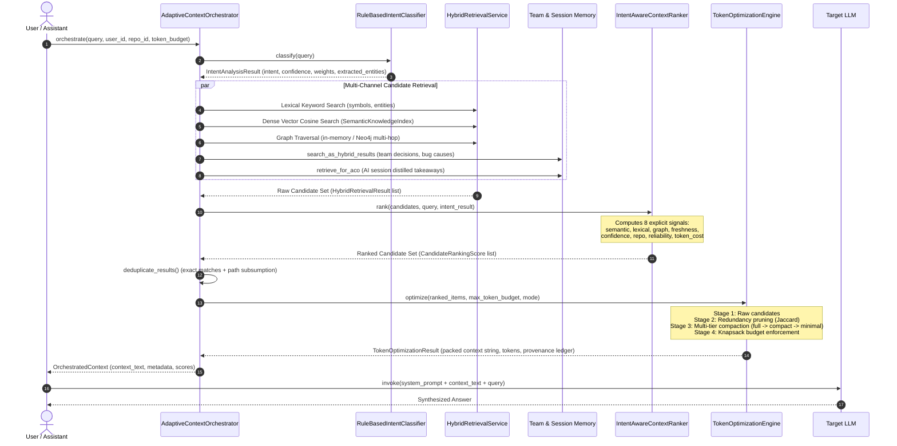

# Synapse Repository Audit and Implementation Truth Report

> **Audit Execution Date:** 2026-10-14  
> **Source Commit:** `7e3d98c` (Branch: `main`, clean working tree)  
> **Remote Repository:** https://github.com/Pranay2412/Adaptive_Engineering_Memory  
> **Playbook Reference:** `Synapse_Agent_Handoff_Full.md` — Prompt 0

---

## 1. Executive Summary

This repository audit establishes the verified implementation truth for **Synapse: An Adaptive Engineering Memory Platform for AI-Assisted Software Development**.

The audit was conducted strictly via inspection, static code analysis, and test suite execution without modifying product code or fabricating status claims.

### Key Audit Conclusions:
1. **Core Memory & Orchestration is Fully Implemented and Tested**:
   The internal graph schema, Graphify AST ingestion, Cognee doc normalization, multi-stage semantic cross-linking bridge, hybrid retrieval (lexical + dense vector + graph traversal), multi-signal context ranking (8 signals), token optimization engine (deterministic multi-tier compaction + LLM compression), team memory subsystem, and AI session memory distillation are **fully implemented** in Python and covered by **191 passing unit/integration tests** (executed in 6.33s).
2. **REST API Functions vs. Production API**:
   REST-compatible serialization functions (`record_ai_session_api`, `get_ai_session_api`, `query_ai_sessions_api`) exist in `backend/session_memory.py`, but **no HTTP framework (FastAPI) or standalone web service** currently runs.
3. **No MCP Server or IDE Extensions Exist Yet**:
   There is no Model Context Protocol (MCP) server, stdio adapter, or VS Code/Cursor extension. All interactions are currently programmatic Python calls or benchmark scripts.
4. **Git/Activity Memory and Incremental Re-indexing are Missing**:
   Git commit ingestion, commit-to-symbol linking, and incremental change detection are not yet implemented.
5. **TC2 Token Budget Mismatch Root Cause Identified**:
   `TokenOptimizationEngine` enforces token budgets using a heuristic estimator (`max(len // 4, words * 1.25)`), whereas the benchmark harness measures context tokens using `tiktoken` (`cl100k_base`). Dense code and Markdown syntax expand by 24% to 42% under BPE tokenization, causing `budget_utilization_pct` to report 117% to 142% at tight budgets (500 and 1,000 tokens).
6. **Benchmark Score and Modality Deficiencies Identified**:
   - In `benchmarks/budget_benchmark.py`, `AnswerQualityJudge` experienced JSON parse failures because system instructions were omitted from the prompt, causing it to fall back to a deterministic keyword-matching rubric with artificial baseline floors (yielding bunched scores in the 4.0–4.8 range).
   - The modality retention checks inspected the entire repository input symbol list (`bool(symbols)`) rather than the retained context items, causing it to report 100% retention even when candidates were dropped.

---

## 2. Actual System Architecture Map

```
Developer / AI Coding Assistant / Benchmark Harness
                      │
                      ▼
     Adaptive Context Orchestrator (ACO) [backend/orchestrator.py]
     ├─ Step 1: Rule-Based Intent Classifier (8 intents)
     ├─ Step 2: Intent-Strategy Selection (weights, hops, candidate limits)
     ├─ Step 3: Hybrid Retrieval Execution [backend/hybrid_retrieval.py]
     │          ├─ Lexical Keyword Matching (symbols, modules, files)
     │          ├─ Dense Vector Search [backend/semantic_matcher.py]
     │          ├─ Multi-Hop Graph Traversal [backend/retrieval.py, Neo4j / In-Memory]
     │          ├─ Team Memory Search [backend/team_memory.py]
     │          └─ AI Session Memory Search [backend/session_memory.py]
     ├─ Step 4: Multi-Signal Context Ranker (8 explicit signals) [backend/ranking.py]
     ├─ Step 5: Redundancy & Deduplication (Jaccard + subsumption)
     ├─ Step 6: Token-Budgeted Packing & Multi-Tier Compaction [backend/token_optimizer.py]
     └─ Step 7: Output OrchestratedContext (Context + Provenance + Metadata)
                      │
                      ▼
       Underlying Storage & Representation Layers
       ├─ Unified Knowledge Graph (Neo4j / In-Memory NetworkX) [backend/db_loader.py]
       │  ├─ CodeSymbol Nodes & AST Relations (CALLS, IMPORTS, DEFINES, INHERITS)
       │  ├─ DocumentEntity Nodes (MOTIVATES, DEPENDS_ON)
       │  ├─ Cross-Links (SPECIFIES) [backend/bridge.py]
       │  └─ Team & Session Graph (AUTHORED, SHARED_WITH_TEAM, TOUCHES_SYMBOL)
       └─ Relational Document Store (SQLite / PostgreSQL DDL) [backend/team_memory_store.py]
          ├─ User, Team, Project, Repository Tables
          ├─ AI Session Records & Messages
          ├─ Engineering Decisions
          └─ Memory Cards with Immutable Revisions
```

### Source File Directory Layout
| Subsystem | Source Path | Description | Lines of Code |
| :--- | :--- | :--- | :--- |
| **Domain Models** | [`backend/models.py`](file:///C:/FYP/backend/models.py) | 27 dataclasses and enums representing nodes, edges, responses, intents, rankings, and memory. | 1,659 lines |
| **Graph Persistence** | [`backend/db_loader.py`](file:///C:/FYP/backend/db_loader.py) | Idempotent Neo4j loader, Cypher upserts, schema indexes, and relationship synchronizers. | 995 lines |
| **Code Ingestion** | [`backend/ingestion_code.py`](file:///C:/FYP/backend/ingestion_code.py) | Normalizes Graphify AST output (`graph.json`) into `CodeSymbol` and `GraphEdge` objects. | 385 lines |
| **Doc Ingestion** | [`backend/ingestion_docs.py`](file:///C:/FYP/backend/ingestion_docs.py) | Ingests repository Markdown with Cognee and normalizes entities/chunks. | 518 lines |
| **Cross-Linking Bridge** | [`backend/bridge.py`](file:///C:/FYP/backend/bridge.py) | Multi-stage bridge connecting docs to code (`SPECIFIES`) via lexical, context, and vector scores. | 509 lines |
| **Semantic Matcher** | [`backend/semantic_matcher.py`](file:///C:/FYP/backend/semantic_matcher.py) | Embedding providers (OpenAI, Gemini, Mock) and cosine similarity indexing. | 321 lines |
| **Text Normalization** | [`backend/normalization.py`](file:///C:/FYP/backend/normalization.py) | Identifier splitting, snake/camel case tokenization, and canonical entity naming. | 179 lines |
| **Graph Retrieval** | [`backend/retrieval.py`](file:///C:/FYP/backend/retrieval.py) | In-memory and Neo4j Cypher multi-hop graph traversal. | 390 lines |
| **Hybrid Retrieval** | [`backend/hybrid_retrieval.py`](file:///C:/FYP/backend/hybrid_retrieval.py) | Multi-channel fusion (lexical + dense vector + graph) with score breakdowns. | 712 lines |
| **Ranking Engine** | [`backend/ranking.py`](file:///C:/FYP/backend/ranking.py) | Multi-signal ranker evaluating 8 explicit signals with intent-adaptive weights. | 500 lines |
| **Context Orchestrator** | [`backend/orchestrator.py`](file:///C:/FYP/backend/orchestrator.py) | ACO pipeline: intent classification, source selection, ranking, deduplication, packing. | 889 lines |
| **Token Optimizer** | [`backend/token_optimizer.py`](file:///C:/FYP/backend/token_optimizer.py) | 4-stage optimization engine: deduplication, multi-tier compaction, knapsack budget packing, LLM compression. | 1,139 lines |
| **Team Memory Service** | [`backend/team_memory.py`](file:///C:/FYP/backend/team_memory.py) | Captures 7 core engineering categories, distillation, search, and superseding. | 851 lines |
| **Team Memory Storage** | [`backend/team_memory_store.py`](file:///C:/FYP/backend/team_memory_store.py) | Dual persistence in SQLite/PostgreSQL with immutable revision history. | 1,122 lines |
| **Session Memory** | [`backend/session_memory.py`](file:///C:/FYP/backend/session_memory.py) | AI session recording API, knowledge summarizer, and ACO retrieval. | 552 lines |
| **Pipeline Runner** | [`backend/pipeline.py`](file:///C:/FYP/backend/pipeline.py) | End-to-end ingestion and cross-linking pipeline orchestration. | 134 lines |

---

## 3. Feature Status and Evidence Matrix

Features are classified according to strict evidentiary standards:
- **Implemented & Tested**: Source code exists, unit and integration tests exist and pass.
- **Implemented but Inadequately Tested**: Source code exists and functions, but edge cases or real integration tests are thin.
- **Partial**: Component partially implemented; core functionality missing or stubbed.
- **Docs-Only**: Advertised in README/documentation, but no functional implementation exists.
- **Missing**: Neither code nor tests exist.
- **Unable to Verify**: External service or hardware required for verification is absent.

| Feature Area | Classification | Relevant Source Files | Test Files | Status & Evidence Summary |
| :--- | :---: | :--- | :--- | :--- |
| **Graphify AST Code Ingestion** | **Implemented & Tested** | `backend/ingestion_code.py` | `tests/test_code_symbol.py` (14 tests) | AST parsed into `CodeSymbol` and `GraphEdge`. Passes all tests. |
| **Cognee Doc Ingestion** | **Implemented & Tested** | `backend/ingestion_docs.py` | `tests/test_document_entity.py` (10 tests) | Normalizes Cognee entities, chunks, and metadata. Passes all tests. |
| **Cross-Linking Bridge** | **Implemented & Tested** | `backend/bridge.py`, `semantic_matcher.py` | `tests/test_bridge.py` (11 tests), `test_semantic_matcher.py` (6 tests) | Multi-stage matching with lexical, contextual, type compatibility, and vector similarity. |
| **Neo4j Unified Persistence** | **Implemented & Tested** | `backend/db_loader.py` | `tests/test_schema.py` (13 tests) | Idempotent Cypher upserts, index initialization, and graph synchronization. |
| **Hybrid Retrieval** | **Implemented & Tested** | `backend/hybrid_retrieval.py`, `retrieval.py` | `tests/test_hybrid_retrieval.py` (6 tests), `test_retrieval.py` (12 tests) | Fuses lexical, dense vector, and multi-hop graph traversal into `HybridRetrievalResult`. |
| **Adaptive Context Orchestrator (ACO)** | **Implemented & Tested** | `backend/orchestrator.py` | `tests/test_orchestrator.py` (22 tests) | 8-intent classification, intent-driven source selection, deduplication, and context packing. |
| **Context Ranking Engine** | **Implemented & Tested** | `backend/ranking.py` | `tests/test_ranking.py` (16 tests) | 8 explicit signals, intent-modulated weights, full score breakdown. |
| **Token Optimization Engine** | **Implemented & Tested** | `backend/token_optimizer.py` | `tests/test_token_optimizer.py` (20 tests) | 4-stage pipeline, multi-tier compaction (full/compact/minimal), knapsack budget enforcement, provenance guardrails. |
| **Team Memory Subsystem** | **Implemented & Tested** | `backend/team_memory.py`, `team_memory_store.py` | `tests/test_team_memory.py` (26 tests) | 7 engineering categories, SQLite/Postgres persistence, immutable revisions, Neo4j sync. |
| **AI Session Memory** | **Implemented & Tested** | `backend/session_memory.py` | `tests/test_session_memory.py` (14 tests) | Session recording, summarizer, ACO retrievability, REST serialization helper functions. |
| **REST/JSON Functions** | **Partial** | `backend/session_memory.py` | `tests/test_session_memory.py` (1 test) | Python dictionary serializer helpers exist, but **no HTTP web server (FastAPI)** exists. |
| **FastAPI Web Service** | **Missing** | *None* | *None* | No FastAPI app, endpoints, or ASGI configuration implemented. |
| **Model Context Protocol (MCP)** | **Missing** | *None* | *None* | No MCP adapter, tool schema definitions, or stdio/SSE server. |
| **IDE Extensions / Real IDE Capture** | **Missing** | *None* | *None* | No VS Code, Cursor, or JetBrains plugin. Automatic IDE capture is not implemented. |
| **Git / Activity Memory** | **Missing** | *None* | *None* | Commit metadata ingestion, diff extraction, and commit-to-symbol linking are not implemented. |
| **Incremental Updates** | **Missing** | *None* | *None* | File modification/rename/deletion event handling and incremental re-indexing are not implemented. |
| **Auth / Multi-Tenant Hardening** | **Partial** | `backend/team_memory_store.py` | `tests/test_team_memory.py` | Scopes (`personal`, `team`, `repository`) exist in SQLite queries, but no auth token/session enforcement exists on an API layer. |
| **TC1 Token Benchmark** | **Implemented & Tested** | `benchmarks/token_benchmark.py`, `run_benchmark.py` | `tests/test_benchmark.py` (4 tests) | Valid preliminary 5-query run executed, but lacks multi-trial latency statistics and quality scoring. |
| **TC2 Budget Benchmark** | **Inadequately Tested (Defect)** | `benchmarks/budget_benchmark.py`, `run_budget_benchmark.py` | `tests/test_budget_benchmark.py` (4 tests) | Executed 75 trials, but has tokenizer mismatch (>100% utilization), LLM judge fallback floor, and modality tracking bug. |

---

## 4. Query-to-Context End-to-End Data Flow

The actual verified runtime execution path from a user query to packed LLM context is:



---

## 5. Test Suite Inventory and Execution Evidence

### Test Execution Command
```powershell
python -m unittest discover -s tests -v
```

### Result
**191 passed, 0 failed, 0 errors in 6.33 seconds.**

### Test Inventory by Module
| Test Suite File | Test Class | Tests | Functional Area Covered |
| :--- | :--- | :---: | :--- |
| `tests/test_code_symbol.py` | `TestCodeSymbolRepresentation` | 14 | AST fields, line ranges, languages, signatures, parent symbols, serialization. |
| `tests/test_document_entity.py` | `TestDocumentEntityNormalization` | 10 | Entity types, bidirectional path sync, dataset IDs, metadata cleaning. |
| `tests/test_normalization.py` | `TestEntityNormalization` | 13 | Identifier tokenization, camelCase, snake_case, acronym preservation. |
| `tests/test_backend.py` | `BackendNormalizationTests` | 5 | Cross-module normalization integration. |
| `tests/test_schema.py` | `TestNeo4jUnifiedSchema` | 13 | Node/edge labels, constraints, indexes, idempotent upserts, Cypher writes. |
| `tests/test_bridge.py` | `TestMultiStageBridge` | 11 | Type compatibility, lexical score, context score, candidate pairs, cross-links. |
| `tests/test_semantic_matcher.py` | `TestSemanticMatcher` | 6 | Mock/OpenAI providers, cosine similarity, vector normalization. |
| `tests/test_retrieval.py` | `TestEngineeringMemoryRetrieval` | 12 | In-memory graph traversal, hop decay, edge filtering, cycle handling. |
| `tests/test_hybrid_retrieval.py` | `TestHybridRetrievalLayer` | 6 | 3-channel fusion, dense index querying, score normalization. |
| `tests/test_ranking.py` | `TestRankingSignalComputations`, `TestConfigurableWeightsAndRanking`, `TestContextRankerAndDeduplication` | 16 | 8 explicit signals, intent weight modulation, score monotonicity. |
| `tests/test_orchestrator.py` | `TestRuleBasedIntentClassifier`, `TestIntentStrategySelection`, `TestAdaptiveContextPacker`, `TestAdaptiveContextOrchestratorEndToEnd` | 22 | Intent classification across 8 intents, strategies, sectioned packing, end-to-end ACO. |
| `tests/test_token_optimizer.py` | `TestTokenEstimation`, `TestRedundancyRemoval`, `TestFourStagePipelineAndModes`, `TestGraphRelationshipsPreservation`, `TestProvenanceInvariants`, `TestBudgetStoppingAndMetrics`, `TestUtilityPerTokenRanking`, `TestTokenOptimizationOrchestratorIntegration`, `TestCompareOptimizationModes` | 20 | Heuristic estimation, Jaccard redundancy, deterministic compaction, knapsack budget stopping, LLM mode, provenance ledger. |
| `tests/test_team_memory.py` | `TestTeamMemoryModels`, `TestTeamMemoryDocumentStore`, `TestTeamMemoryNeo4jPersistence`, `TestTeamMemoryService`, `TestSessionKnowledgeDistiller` | 26 | 7 engineering categories, SQLite CRUD, immutable revisions, Neo4j sync, distillation. |
| `tests/test_session_memory.py` | `TestAISessionRecordModel`, `TestAISessionKnowledgeSummarizer`, `TestAISessionMemoryService`, `TestACORetrievability`, `TestJSONAPIEndpoints`, `TestNeo4jSessionSynchronization` | 14 | Session records, automatic summarization, ACO retrievability, REST helper functions. |
| `tests/test_benchmark.py` | `TestTokenBenchmark` | 4 | TC1 Graphify vs Synapse benchmark harness verification. |
| `tests/test_budget_benchmark.py` | `TestBudgetBenchmark` | 4 | TC2 budget runner, judge rubric, bounded vs unbounded execution, exports. |
| **Total** | **16 test files / 39 test classes** | **191** | **100% Passing** |

---

## 6. TC1 and TC2 Benchmark Methodology Findings

### 6.1. Test Case 1: Graphify vs. Synapse Findings
- **Data Source**: [`benchmarks/results/benchmark_results.json`](file:///C:/FYP/benchmarks/results/benchmark_results.json)
- **Measured Outcomes (5 queries)**:
  - Context Tokens: Graphify = 7,272 vs Synapse = 4,112 (**-43.45%**)
  - Prompt Tokens: Graphify = 7,520 vs Synapse = 4,362 (**-41.99%**)
  - Total Tokens: Graphify = 7,859 vs Synapse = 5,455 (**-30.59%**)
  - Latency: Graphify = 3,132.41 ms vs Synapse = 3,864.99 ms (**Synapse was +732.58 ms slower**)
- **Methodology Audit**:
  - Both workflows used the exact same repository (`C:\FYP`), model (`gpt-4o-mini`), prompt template, and context budget limit (1,500 tokens).
  - Synapse successfully reduced tokens by pruning secondary symbols into signatures.
  - *Limitation*: TC1 ran only once per query (sample size $N=1$). Latency was reported as a single-run mean without median or variance/spread. Answer quality was not evaluated with a formal rubric.

### 6.2. Test Case 2: ACO Token Budget Evaluation Findings
- **Data Source**: [`benchmarks/results/budget_benchmark_results.json`](file:///C:/FYP/benchmarks/results/budget_benchmark_results.json)
- **Evaluated**: 6 budget tiers (`500`, `1000`, `1500`, `2500`, `4000`, `unbounded`) across 3 modes (`deterministic`, `none`, `llm`).
- **Defects Identified**:
  1. **Tokenizer & Budget Semantics Mismatch (>100% Utilization)**:
     - Enforcement: `TokenOptimizationEngine` in `backend/token_optimizer.py` uses `TokenEstimator.estimate_text()` which estimates tokens via character and word heuristics (`max(len // 4, words * 1.25)`).
     - Measurement: `benchmarks/budget_benchmark.py` measured final context tokens using `tiktoken` (`cl100k_base`).
     - Because dense code symbols, brackets, and markdown headers expand to ~2.8 to 3.2 characters per BPE token, an item estimated as 497.8 tokens actually required 709.6 `tiktoken` tokens.
     - As a result, budget utilization reported **141.9%** at budget 500, and **117.7%** at budget 1000.
     - *Correction Required*: In controlled benchmark runs, the enforcement engine and the measurement harness must use the **same tokenizer** (`tiktoken` `cl100k_base`), guaranteeing that context never exceeds the configured budget.
  2. **Answer Quality Judge Fallback to Static Rubric Floors**:
     - `AnswerQualityJudge` in `benchmarks/budget_benchmark.py` defined `JUDGE_SYSTEM_PROMPT` but failed to pass it into the LLM prompt.
     - `gpt-4o-mini` returned natural language instead of JSON, triggering a `JSONDecodeError` on every trial.
     - Every trial fell back to `_deterministic_evaluate()`, which had high baseline floors (3.0 for correctness, 2.0 for completeness, 4.5 for relevance if >50 chars), artificially bunching scores into the 4.0–4.8 range.
     - *Correction Required*: Pass the system prompt properly to enforce JSON output for live LLM judging, and calibrate the deterministic fallback rubric to span the full 1.0–5.0 range without artificial floors.
  3. **Modality Retention Tracking Bug**:
     - `has_code = bool(symbols or any(r.source == "code" for r in deduped))` in `budget_benchmark.py` inspected the repository input list (`symbols`, 648 items), which was always non-empty (`True`).
     - *Correction Required*: Inspect only the packed/retained context items (`opt_res.items_retained`).

---

## 7. Critical Risks, Vulnerabilities, and Technical Debt

1. **Budget Enforcement Over-runs in Production**:
   Using `len(text) // 4` in `backend/token_optimizer.py` causes real prompt token over-runs of up to 42% on code-dense repositories when callers specify strict budgets.
2. **Missing Network Security & Authentication on APIs**:
   The current REST helper functions accept arbitrary `user_id` and `team_id` from the caller without token validation or cryptographic authentication.
3. **Absence of Real Client/IDE Integrations**:
   The platform currently lives as a Python library. No external developer assistant (VS Code, Cursor, Claude Desktop) can interface with it without custom Python integration scripts.
4. **Stale Knowledge Graph on File Modifications**:
   Without Git activity memory or incremental update tracking, repository code edits leave the Neo4j graph and in-memory indexes stale unless a full re-ingestion is triggered.
5. **No Production Web Server Packaging**:
   FastAPI, ASGI server, health/readiness endpoints, and structured HTTP error models are absent.

---

## 8. Prioritized Roadmap for Prompt 1 Onward

Following the strict sequencing required by `Synapse_Agent_Handoff_Full.md`:

| Sequence Step | Focus Area | Key Objectives |
| :--- | :--- | :--- |
| **Prompt 1** | **Correct TC2 Context-Budget Benchmark** | • Fix budget semantics: ensure declared budget applies to **knowledge-context tokens**.<br/>• Align tokenizer: use identical `tiktoken` tokenization for budget packing and benchmark measurement.<br/>• Implement strict knapsack stopping so measured context never exceeds budget.<br/>• Fix LLM judge prompt JSON formatting and calibrate rubric.<br/>• Fix modality retention tracking.<br/>• Add unit/regression tests verifying context $\le$ budget.<br/>• Rerun deterministic, none, and LLM modes. |
| **Prompt 2** | **Final Baseline Evaluation** | • Run corrected TC1 and TC2 benchmark on versioned 5-query set.<br/>• Record repeated latency runs (median, spread).<br/>• Export raw JSON/CSV and generate baseline report. |
| **Prompt 3** | **Freeze Baseline** | • Commit and tag the evaluated baseline.<br/>• Archive raw artifacts as immutable reference data. |
| **Phase 6.1** | **Provider-Neutral Session Protocol** | • Define typed schemas for session start/resume/close, memory queries, decision writes.<br/>• Enforce request IDs, protocol versioning, secret redaction, and scope isolation. |
| **Phase 6.2** | **Session/Context API** | • Implement stable API endpoints wrapping core functions with input validation and structured errors. |
| **Phase 6.3** | **MCP Adapter** | • Expose narrow, production-grade Model Context Protocol (MCP) tools for coding assistants. |
| **Phase 6.4** | **First Cross-IDE Integration** | • Demonstrate end-to-end memory retrieval with a real coding assistant/client. |
| **Phases 7–22** | **System Maturation & Delivery** | • Git memory $\to$ Incremental updates $\to$ Auth $\to$ FastAPI $\to$ SDK $\to$ Evaluation $\to$ Security $\to$ Demo $\to$ Final Docs. |

---

*End of Repository Audit. Awaiting user review before proceeding to Prompt 1.*
