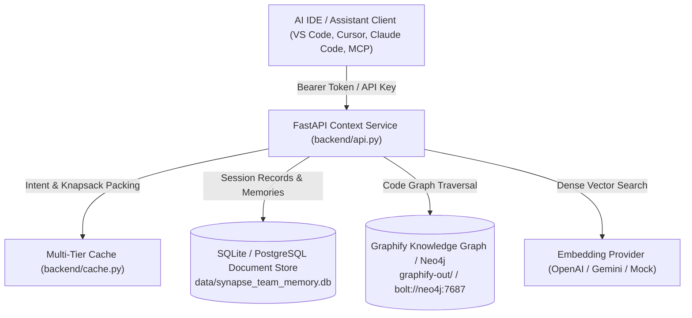

# Synapse: Operations & Deployment Guide (Phase 17)

This guide documents the procedures for deploying, configuring, operating, migrating, backing up, and troubleshooting the **Synapse Adaptive Engineering Memory Platform** in local development, containerized environments, and production hosting.

---

## 1. Architectural Topology & External Services

Synapse exposes provider-neutral context orchestration, session tracking, and engineering memory persistence. The platform interacts with three primary external subsystems:



### External Services Matrix

| Service | Role | Requirement | Default / Fallback |
| :--- | :--- | :--- | :--- |
| **Relational / Document DB** | Persistent storage for users, sessions, ADR memories, and audit logs | **Required** | Local SQLite (`data/synapse_team_memory.db`) or PostgreSQL |
| **Code Knowledge Graph** | AST symbol definitions, relationships, and file citations | **Required** | Local Graphify artifacts (`graphify-out/graph.json`) or Neo4j |
| **Vector Embedding API** | Dense vector search for semantic candidate retrieval | Optional | `openai` (`text-embedding-3-small`), `gemini`, or deterministic offline `mock` |
| **LLM Provider** | Query-guided extraction and adaptive context compression | Optional | `openai` (`gpt-4o-mini`), `gemini`, or `deterministic` rule-based compressor |

---

## 2. Resource Sizing & Hardware Constraints

| Deployment Tier | Workload Profile | CPU | RAM | Disk Storage | Network Bandwidth |
| :--- | :--- | :--- | :--- | :--- | :--- |
| **Local Dev / Evaluation** | Single-developer, single-repo (<10k symbols) | 2 Cores | 2 GB | 1 GB SSD | Basic Internet (if using remote LLM) |
| **Team Staging** | 5–20 concurrent sessions, 5 repositories | 2–4 Cores | 4 GB | 10 GB SSD | 100 Mbps |
| **Enterprise Production** | 50+ concurrent sessions, cross-tenant RBAC | 4–8 Cores | 8–16 GB | 50 GB NVMe | 1 Gbps |

**Runtime Constraints:** Python 3.11, 3.12, 3.13, or 3.14.

---

## 3. Configuration Matrix (`.env.example`)

All configuration parameters can be supplied via environment variables or a local `.env` file loaded at service initialization.

| Variable Name | Type | Default | Description & Security Guardrails |
| :--- | :--- | :--- | :--- |
| `SYNAPSE_ENV` | `str` | `development` | Runtime mode: `development`, `staging`, `production`, `testing`. |
| `SYNAPSE_HOST` | `str` | `127.0.0.1` | Network interface to bind (`0.0.0.0` inside containers). |
| `SYNAPSE_PORT` | `int` | `8000` | HTTP service port (1–65535). |
| `SYNAPSE_SECRET_KEY` | `str` | *dev-default* | HMAC-SHA256 bearer signing secret. **Must be >= 32 characters in production.** |
| `SYNAPSE_REQUIRE_AUTH` | `bool` | `false` | When `true`, rejects unauthenticated requests with `401 Unauthorized`. |
| `SYNAPSE_DB_PATH` | `str` | `data/synapse_team_memory.db` | File path for SQLite storage. Directory created automatically. |
| `SYNAPSE_CORS_ORIGINS` | `list` | `*` | Allowed CORS origins. **Wildcard `*` is strictly forbidden in production when auth is enabled.** |
| `SYNAPSE_REQUEST_TIMEOUT` | `float` | `30.0` | Maximum request duration in seconds before returning `504 Gateway Timeout`. |
| `SYNAPSE_MAX_PAYLOAD_BYTES`| `int` | `10485760` | Maximum body size (10 MB). Oversized requests return `413 Payload Too Large`. |
| `SYNAPSE_LOG_LEVEL` | `str` | `INFO` | Structured logging verbosity: `DEBUG`, `INFO`, `WARNING`, `ERROR`. |
| `NEO4J_URI` | `str` | `bolt://localhost:7687` | Neo4j Bolt connection URI. |
| `NEO4J_USERNAME` | `str` | `neo4j` | Neo4j connection user. |
| `NEO4J_PASSWORD` | `str` | *placeholder* | Neo4j user password. |
| `EMBEDDING_PROVIDER` | `str` | `openai` | Dense embedding engine: `openai`, `gemini`, or `mock`. |
| `OPENAI_API_KEY` | `str` | *unset* | OpenAI API Key for dense vector embeddings and LLM compression. |

---

## 4. Local Deployment (Clean Checkout)

A second developer can deploy Synapse on a clean workstation following these steps:

### Step 1: Clone and Navigate
```bash
git clone <repository-url>
cd FYP
```

### Step 2: Set Up Virtual Environment & Dependencies
```bash
python -m venv .venv

# On Linux/macOS:
source .venv/bin/activate

# On Windows (PowerShell):
.\.venv\Scripts\Activate.ps1

# Install pinned core dependencies
pip install --upgrade pip
pip install -r requirements.txt
```

### Step 3: Initialize Environment Configuration
```bash
# Copy template into active environment
cp .env.example .env

# Generate a strong production secret key (e.g. 32+ random characters)
# Edit .env and set SYNAPSE_SECRET_KEY to your generated value.
```

### Step 4: Apply Database Migrations
```bash
python scripts/migrate.py up
```

Output:
```text
Applying 4 pending migrations to data/synapse_team_memory.db...
  [OK] Applied version 1
  [OK] Applied version 2
  [OK] Applied version 3
  [OK] Applied version 4
Migration complete. Schema version is now 4.
```

### Step 5: Verify Schema Integrity
```bash
python scripts/migrate.py verify
```

### Step 6: Start the Service
```bash
python -m uvicorn backend.api:app --host 127.0.0.1 --port 8000
```

### Step 7: Access Dashboard & Probes
- **Interactive Dashboard:** `http://127.0.0.1:8000/dashboard`
- **Liveness Probe:** `http://127.0.0.1:8000/health` (HTTP 200 `{"status": "ok"}`)
- **Readiness Probe:** `http://127.0.0.1:8000/ready` (HTTP 200 `{"status": "ready"}`)
- **API Documentation:** `http://127.0.0.1:8000/docs` (available when `SYNAPSE_ENV != production`)

---

## 5. Containerized Deployment (Docker & Compose)

### Running with Docker Compose (Recommended)

1. **Launch Core Service (FastAPI + SQLite + Cache):**
   ```bash
   docker compose up -d synapse-api
   ```

2. **Launch Full Enterprise Stack (with Neo4j Graph DB):**
   ```bash
   docker compose --profile full up -d
   ```

3. **Check Container Status and Health:**
   ```bash
   docker compose ps
   ```

4. **Stream Container Logs:**
   ```bash
   docker compose logs -f synapse-api
   ```

5. **Stop Containers Safely:**
   ```bash
   docker compose down
   ```

### Building the Production Docker Image Directly

```bash
docker build -t synapse-platform:latest .
docker run -d \
  --name synapse-platform \
  -p 8000:8000 \
  -v synapse_data:/app/data \
  -v synapse_backups:/app/backups \
  -e SYNAPSE_ENV=production \
  -e SYNAPSE_SECRET_KEY="your-32-char-cryptographic-secret-here" \
  -e SYNAPSE_REQUIRE_AUTH=true \
  synapse-platform:latest
```

---

## 6. Database Migrations & Version Management

Database schema versions are recorded in the `schema_migrations` table. Each migration step executes in an atomic transaction.

### Checking Migration Status
```bash
python scripts/migrate.py status
```

### Applying Pending Migrations
```bash
python scripts/migrate.py up
```

### Verifying Schema Integrity
```bash
python scripts/migrate.py verify
```

### Migration History

| Version | Migration Name | Key Tables Created / Modified |
| :--- | :--- | :--- |
| **v1** | `initial_core_team_memory_schema` | `users`, `teams`, `projects`, `repositories`, `ai_sessions`, `engineering_decisions`, `memories`, `git_commits` |
| **v2** | `incremental_checkpoints_and_indexing` | `incremental_checkpoints`, `idx_checkpoints_repo` |
| **v3** | `security_audit_and_api_keys` | `security_audit_events`, `api_keys`, `idx_api_keys_hash`, `idx_audit_tenant_time` |
| **v4** | `performance_composite_indexes` | Composite indexes on `(repository_id, started_at)`, `(category, scope)`, `(tenant_id, timestamp)` |

---

## 7. Backup and Disaster Recovery

Synapse provides zero-downtime, checksum-verified backups using SQLite's online backup API paired with knowledge graph artifact preservation.

### Creating a Backup Snapshot
```bash
python scripts/backup_restore.py create --note "Pre-upgrade snapshot"
```
Output:
```text
Creating backup from db 'data/synapse_team_memory.db' and graph 'graphify-out'...
[OK] Backup created successfully: backups/synapse_backup_20261015_070012.tar.gz
     Backup ID:      synapse_backup_20261015_070012
     Schema Version: 4
     Database Size:  209579 bytes
     Files Included: 4
```

### Listing Available Backups
```bash
python scripts/backup_restore.py list
```

### Verifying Cryptographic Checksums of an Archive
```bash
python scripts/backup_restore.py verify backups/synapse_backup_20261015_070012.tar.gz
```

### Restoring from Backup
Restoration verifies cryptographic digests prior to unpacking and maintains an automatic rollback safety copy (`.pre-restore.bak`) in case of unexpected disk or execution errors:

```bash
python scripts/backup_restore.py restore backups/synapse_backup_20261015_070012.tar.gz
```

---

## 8. Upgrades and Safe Rollback Workflows

### Standard Upgrade Procedure

1. **Pre-Upgrade Snapshot:**
   ```bash
   python scripts/backup_restore.py create --note "Pre-upgrade backup"
   ```
2. **Pull Latest Release:**
   ```bash
   git pull origin main
   pip install --upgrade -r requirements.txt
   ```
3. **Execute Schema Migrations:**
   ```bash
   python scripts/migrate.py up
   python scripts/migrate.py verify
   ```
4. **Restart Application Service:**
   ```bash
   # In Docker:
   docker compose restart synapse-api
   ```
5. **Run Smoke Test Verification:**
   ```bash
   python scripts/smoke_test.py
   ```

### Rollback Procedure (In Case of Deployment Failure)

1. **Restore Pre-Upgrade Database Snapshot:**
   ```bash
   python scripts/backup_restore.py restore backups/<pre-upgrade-archive>.tar.gz
   ```
2. **Revert Application Code:**
   ```bash
   git checkout <previous-stable-tag-or-sha>
   pip install -r requirements.txt
   ```
3. **Restart Service & Verify Health:**
   ```bash
   curl -f http://127.0.0.1:8000/health
   curl -f http://127.0.0.1:8000/ready
   ```

---

## 9. Security & Production Hardening Checklist

- [x] **Unprivileged Container User:** Dockerfile enforces `USER synapse:synapse` (UID 10001). Root execution is disallowed.
- [x] **Mandatory Cryptographic Secret:** Set `SYNAPSE_SECRET_KEY` to a random 32+ character string in `.env`.
- [x] **Enforce Authentication:** Set `SYNAPSE_REQUIRE_AUTH=true` in production to prevent unauthenticated access.
- [x] **Strict CORS Policy:** Define explicit origins in `SYNAPSE_CORS_ORIGINS` (e.g. `https://synapse.internal`). Wildcard `*` is automatically rejected by configuration validation in production.
- [x] **Bounded Timeouts & Payloads:** `SYNAPSE_REQUEST_TIMEOUT=30.0` prevents hung processes; `SYNAPSE_MAX_PAYLOAD_BYTES=10485760` prevents resource exhaustion.
- [x] **Credential Masking:** Diagnostic endpoint `/api/v1/config` redacts all secrets and never returns plaintexts.
- [x] **Audit Trail Persistence:** Every authorization check and administrative action is logged to `security_audit_events`.

---

## 10. Smoke Test Automation

To verify that the entire environment is fully functioning from checkout, run the automated smoke test suite:

```bash
# Standalone CLI validation (executes all 6 validation stages):
python scripts/smoke_test.py

# Pytest regression suite:
python -m pytest tests/test_deployment_smoke.py -v
```
